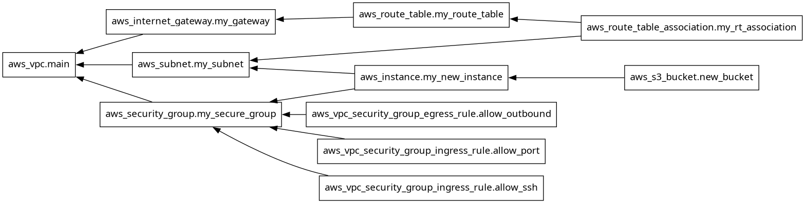

# Day 62 -- Providers, Resources and Dependencies
## TASK-1
1. I create a new project directory: `terraform-aws-infra`
2. I write a **"providers.tf"** file:
   - I define the `terraform` block with `required_providers` pinning the AWS provider to version `~> 5.0`
   - I define the `provider "aws"` block with your region
3. Run `terraform init` and check the output -- what version was installed?
    ```bash
    Terraform v1.16.6
    on linux_amd64
    + provider registry.terraform.io/hashicorp/aws v5.100.0
    ```
4. Read the provider lock file `.terraform.lock.hcl` -- what does it do?
    - `.terraform.lock.hcl` is a Dependency Lock File. Terraform automatically creates it during terraform init.
    - It records the exact version of the cloud provider plugin (like AWS)
    - It saves unique security hashes for the plugin binaries.

#### Document: What does `~> 5.0` mean? How is it different from `>= 5.0` and `= 5.0.0`?
* **~> 5.0 (Pessimistic - Best Practice):** Allows safe, minor updates and bug fixes (like 5.1 or 5.99).
* **>= 5.0 (Optimistic - High Risk):** it is highly risky because it auto-installs upcoming versions, which cause pipeline crash/failure if cloud vendor fails.

---

### TASK-2
I create a **"main.tf"** and define these resources one by one:

1. `aws_vpc` -- CIDR block `10.0.0.0/16`, tag: `"TerraWeek-VPC"`
2. `aws_subnet` -- CIDR block `10.0.1.0/24`, reference the VPC ID from step 1, enable public IP on launch, tag it `"TerraWeek-Public-Subnet"`
3. `aws_internet_gateway` -- attach it to the VPC
4. `aws_route_table` -- create it in the VPC, add a route for `0.0.0.0/0` pointing to the internet gateway
5. `aws_route_table_association` -- associate the route table with the subnet

Run `terraform plan` -- you should see 5 resources to create.

* I forget to take Screenshot of `terraform plan`


#### Verify: Apply and check the AWS VPC console. Can you see all five resources connected?
* **YES!** all five resources are live

---

### Task 3: Understand Implicit Dependencies
1. The subnet references `aws_vpc.main.id` -- this is an implicit dependency
2. The internet gateway references the VPC ID -- another implicit dependency
3. The route table association references both the route table and the subnet

#### How does Terraform know to create the VPC before the subnet?
* Terraform knows to create the VPC before the subnet because of an Implicit Dependency built into the code.
    - Implicit Code : **vpc_id = aws_vpc.main.id**

#### What would happen if you tried to create the subnet before the VPC existed?
* If you tried to create the subnet before the VPC existed, the deployment would crash immediately with an API error from AWS.
* AWS requires a valid pre-existing parent VPC ID to carve out a subnet partition. Because the VPC wouldn't exist yet, AWS would reject the request and return an error like **InvalidVpcID.NotFound**
#### Find all implicit dependencies in your config and list them

---

## TASK-4 
Add to config:

1. `aws_security_group` in the VPC:
   - Ingress rule: allow SSH (port 22) from `0.0.0.0/0`
   - Ingress rule: allow HTTP (port 80) from `0.0.0.0/0`
   - Egress rule: allow all outbound traffic
   - Tag: `"TerraWeek-SG"`


2. `aws_instance` in the subnet:
   - Use Amazon Linux 2 AMI for your region
   - Instance type: `t2.micro`
   - Associate the security group
   - Set `associate_public_ip_address = true`
   - Tag: `"TerraWeek-Server"`


#### Apply and Verify -- your EC2 instance should have a public IP and be reachable.
* **YES!** My EC2 instance have a public IP and it's reachable.

---

## TASK-5
Sometimes Terraform cannot detect a dependency automatically.

1. I add a second `aws_s3_bucket` resource for application logs
2. I add `depends_on = [aws_instance.main]` to the S3 bucket -- even though there is no direct reference, you want the bucket created only after the instance
3. Run `terraform plan` and observe the order

* Now i visualize the entire dependency tree
    ```bash
    terraform graph
    ```

  ```

#### Document: When would you use `depends_on` in real projects? Give two examples.

---

### Task 6: Lifecycle Rules and Destroy
1. Add a `lifecycle` block to your EC2 instance:
    ```hcl
    lifecycle {
      create_before_destroy = true
    }
    ```
2. Change the AMI ID to a different one and run `terraform plan` -- observe that Terraform plans to create the new instance before destroying the old one

3. Destroy everything:
    ```bash
    terraform destroy
    ```
4. Watch the destroy order -- Terraform destroys in reverse dependency order. 

#### Verify in the AWS console that everything is cleaned up.
* **YES!** is cleaned.

#### Document: What are the three lifecycle arguments (`create_before_destroy`, `prevent_destroy`, `ignore_changes`) and when would you use each?
* **Create_before_destroy:** Launches new before deleting old. Use for zero-downtime rolling upgrades on web servers.
* **Prevent_destroy:** Blocks deletion commands. Use to prevent accidental data drops on databases or core storage buckets.
* **Ignore_changes:** Ignores outside/manual edits. Use for auto-scaling size limits or values tweaked dynamically outside of code.

#### Explanation of implicit vs explicit dependencies in your own words
* **Implicit dependency :** Terraform automatically figures out the creation of resources because they are linked together by a variable code.
* Terraform reads files in the system and sees the required information from files and arrange them to a sequencial order.
* Example : `subnet_id = aws_subnet.my_subnet.id`

* **Explicit dependency :** when two tasks are completely separate, but can be force manually to wait for other task.
* In Terraform two tasks didn't share any values to each other, but one must be fully active first to prevent a cloud network error, it all controls manually by inline HCL commands to wait for task to be done before another task executes by command `depends_on`
