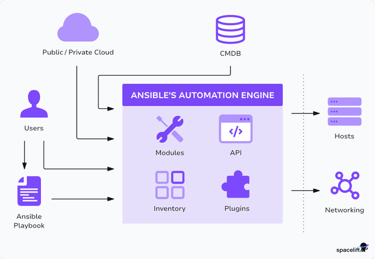

# Day 68 -- Introduction to Ansible and Inventory Setup
## TASK-1
### Short notes on:
#### What is configuration management? Why do we need it?
* Configuration management is a process that automates the maintainance of application servers in a consistent, predictable, and identical state using code.
* It completely eliminates human error, prevents configuration errors between servers, and cuts down the time to rebuild a crashed environment from days to minutes.

#### How is Ansible different from Chef, Puppet, and Salt?
* **Ansible:** 
    - Pushes out updates on demand from a control terminal.
    - It use YAML a simple, easily readable, and declarative.
* **Chef:**
    - It use Pull to check master server for code.
    - It use Ruby which is domain-specific coding.
* **Puppet:**
    - It use Pull to System daemons periodically pull configs down.
    - It use Puppet DSL a declarative configuration language.
* **Salt:**
    - Hybrid it Uses a fast zeroMQ queue system to push/pull.
    - It use YAML/Python basic text or procedural logic.

#### What does "agentless" mean? How does Ansible connect to managed nodes?
* **Agentless:**  means zero background software or daemons need to be installed on target destination servers for Ansible to manage them.

* built-in communication channels. For Linux nodes, it logs in securely over standard SSH using `.pem` key and private-key file, executes the requested code modules.
#### Draw or describe the Ansible architecture:
* Architecture explain
    - Control Node -- the machine where Ansible runs (laptop or a jump server)
    - Managed Nodes -- the servers Ansible configures (your EC2 instances)
    - Inventory -- the list of managed nodes
    - Modules -- units of work Ansible executes (install a package, copy a file, start a service)
    - Playbooks -- YAML files that define what to do on which hosts


## TASK-2
You need 2-3 EC2 instances to practice on. Choose one approach:

* **Option A: Use Terraform (recommended -- you just learned this)** Use your TerraWeek skills to provision 3 EC2 instances with:
    - Amazon Linux 2 or Ubuntu 22.04
    - t2.micro instance type
    - A security group allowing SSH (port 22)
    - A key pair for SSH access

* **Option B: Launch manually from AWS Console** Create 3 instances with the same specs above

#### Verify you can SSH into each one from your control node:
```bash
ssh -i ~/your-key.pem ec2-user@<public-ip-1>
ssh -i ~/your-key.pem ec2-user@<public-ip-2>
ssh -i ~/your-key.pem ec2-user@<public-ip-3>
```
## TASK-3
* Install Ansible on your control node (your laptop or one dedicated EC2 instance):
```bash
# Ubuntu/Debian
sudo apt update
sudo apt install ansible -y

# Amazon Linux / RHEL
sudo yum install ansible -y
# or
pip3 install ansible
```
```bash
# Verify
ansible --version
ansible [core 2.16.3]
  config file = None
  configured module search path = ['/home/ubuntu/.ansible/plugins/modules', '/usr/share/ansible/plugins/modules']
  ansible python module location = /usr/lib/python3/dist-packages/ansible
  ansible collection location = /home/ubuntu/.ansible/collections:/usr/share/ansible/collections
  executable location = /usr/bin/ansible
  python version = 3.12.3 (main, Aug 31 2026, 10:18:26) [GCC 13.3.0] (/usr/bin/python3)
  jinja version = 3.1.2
  libyaml = True
```
#### On which machine did you install Ansible? Why is it only needed on the control node?
* I install Ansible in **Ubuntu24.04LTS** machine, Because only control node is responsible for managinging worker/server nodes.

## TASK-4
The inventory tells Ansible which servers to manage. Create a project directory and first inventory:
```bash
mkdir ansible-practice && cd ansible-practice
```
Create a file called inventory.ini:
```ini
[servers]
worker-node-1 ansible_host=35.166.32.220 ansible_user=ec2-user
worker-node-2 ansible_host=54.186.232.10 ansible_user=ec2-user

[all:vars]
ansible_python_interpreter=auto_silent
ansible_ssh_private_key_file=/home/ubuntu/key/ansible-key
```

#### Verify Ansible can reach all hosts:
```bash
ansible all -i inventory.ini -m ping
```


## TASK-5
Ad-hoc commands to run quick one-off tasks without writing a playbook.

1. **Check uptime on all servers:**
    ```bash
    ansible all -i inventory.ini -m command -a "uptime"
    ```

2. **Check free memory on web servers only:**
    ```bash
    ansible web -i inventory.ini -m command -a "free -h"
    ```

3. **Check disk space on all servers:**
    ```bash
    ansible all -i inventory.ini -m command -a "df -h"
    ```

4. **Install a package on the web group:**
    ```bash
    ansible web -i inventory.ini -m dnf -a    "name=git state=present" --become
    ```

5. **Copy a file to all servers:**
    ```bash
    echo "Hello from Ansible" > hello.txt && ansible all -i inventory.ini -m copy -a "src=hello.txt dest=/tmp/hello.txt"
    ```


#### Verify the file was copied:
```bash
ansible all -i inventory.ini -m command -a "cat /tmp/hello.txt"
```


#### What does --become do? When do you need it?
* `--become` works satorme as sudo command in linux which gives root/adminitration permission  and run to execute sensitive and adminitration commands.
* We need it whenever a task requires root/administrator permissions on the target Linux machine.

## TASK-6
#### Use patterns:
```bash
ansible 'worker-node-1:worker-node-2' -i inventory.ini -m ping        # OR: web or app
```
* Create an ansible.cfg to avoid typing -i inventory.ini every time:
```bash
[defaults]
inventory = inventory.ini
host_key_checking = False
remote_user = ec2-user
private_key_file = ~/your-key.pem
```
Now you can simply run:
```bash
ansible all -m ping
```
#### Verify: Does ansible all -m ping work without specifying the inventory file?
* **YES!** ansible ping all work without specifying the inventory file.


